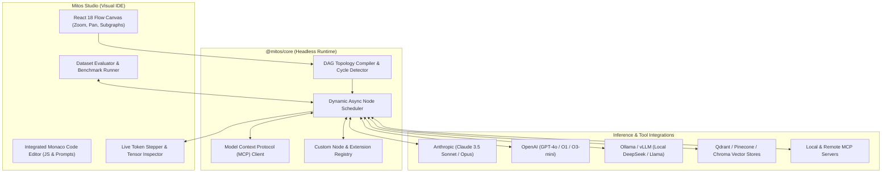

<p align="center">
  
</p>

<p align="center">
  <strong>Visual AI DAG Graph Execution IDE, Multi-Agent Orchestrator & Autonomous Flow Studio</strong>
</p>

<p align="center">
  <a href="https://www.linkedin.com/in/akashjadon"></a>
  <a href="https://github.com/akashjadon04"></a>
  
  
  
</p>

---

## ⚡ Executive Summary

**Mitos** (inspired by the thread of Ariadne navigating the labyrinth) is an advanced visual node graph development environment and execution runtime for complex AI applications, autonomous agents, and deterministic DAG pipelines.

While black-box agent frameworks (LangChain, CrewAI, AutoGen) force developers into brittle Python code loops that fail silently in production, Mitos enables you to visually construct, inspect, step-debug, and evaluate complex multi-agent architectures with zero ambiguity. Workflows constructed in Mitos Studio can be executed headlessly inside any backend or edge worker using the zero-dependency `@mitos/core` engine.

---

## 🏛️ Graph Execution Architecture



---

## 💎 Core Technical Capabilities

| Capability | Specification | Architectural Advantage |
| :--- | :--- | :--- |
| **Deterministic DAG Engine** | Topologically sorted execution with dynamic loop branching | Eliminates infinite hallucination loops common in pure prompt agents. |
| **Native MCP Support** | Full Model Context Protocol tool discovery & invocation | Connects seamlessly to any local or remote MCP server for database access, shell, or web browsing. |
| **Zero-Dependency Core** | `@mitos/core` runs anywhere (Node, Deno, Cloudflare Workers, Web) | Design once in the GUI; deploy headlessly as a microservice in 10 lines of code. |
| **Visual Step Debugging** | Inspect input/output tensors at every single node in real-time | Trace token latency, prompt injections, and evaluation scores node-by-node. |
| **Multi-Provider Unified** | Switch between OpenAI, Anthropic, Gemini, Groq, Ollama without rewrites | Unified prompt syntax with variable injection, structured outputs, and fallback chains. |

---

## 🚀 Headless Execution Example (`@mitos/core`)

Run any Mitos project file programmatically inside your backend:

```typescript
import { runGraph, loadProjectFromString } from '@mitos/core';
import * as fs from 'fs';

// 1. Load the visual graph project
const projectFile = fs.readFileSync('./lead-scoring-agent.mitos-project', 'utf8');
const project = loadProjectFromString(projectFile);

// 2. Execute graph with dynamic runtime inputs
const outputs = await runGraph(project, {
  graph: 'MainAgentFlow',
  inputs: {
    leadEmail: 'enterprise-vp@fortune500.com',
    companyDomain: 'fortune500.com'
  },
  openAiKey: process.env.OPENAI_API_KEY,
  anthropicKey: process.env.ANTHROPIC_API_KEY
});

console.log('Resulting Decision:', outputs.decision.value);
```

---

## 👨‍💻 Developer & Architect

<div align="center">
  <h3>Designed, Built & Maintained by <strong>Akash Jadon</strong></h3>
  <p><em>Autonomous Agent Architect | Distributed Systems Engineer | Platform Specialist</em></p>
  
  <a href="https://www.linkedin.com/in/akashjadon">
    
  </a>
  <a href="https://github.com/akashjadon04">
    
  </a>
</div>

---

## 📜 Sovereign Ownership & License

Decoupled and re-engineered as **Mitos Studio**. Maintained as a private, high-performance technology asset developed by **Akash Jadon**. All upstream telemetry, Discord webhooks, and third-party trackers have been permanently excised.\n